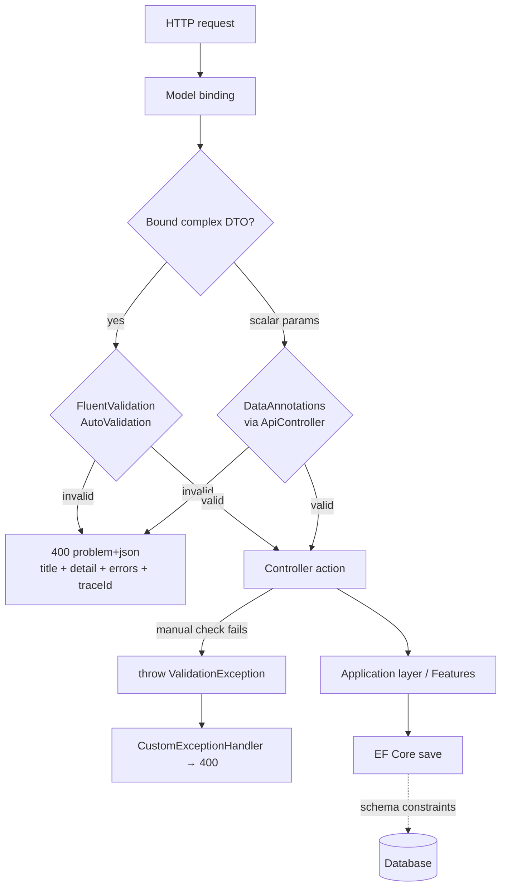

# Validation Policy

## Overview

This document describes how input validation works across YoFi.V3. Validation is
layered: each layer has a distinct responsibility, from request-shape checks at the
API boundary down to database schema constraints at persistence time. The primary
strategy for validating request bodies is **FluentValidation**, run automatically at
the controller boundary.

## Implementation Follow-ups

- Ensure every client-originated `400 Bad Request` response uses
  `ValidationProblemDetails` (or `HttpValidationProblemDetails`) with `errors` and a
  trace ID. Plain `ProblemDetails` is not sufficient for validation failures.
- The `InvalidModelStateResponseFactory` currently synthesizes a combined `detail`
  string from the structured errors. This synthesis is deprecated: new code should rely
  on `title`, `detail`, `errors`, and `traceId`, and keep existing behavior only until
  the response factory is updated.

## Core Principles

1. **Validate at the boundary** - Invalid requests are rejected before reaching
   controller actions or the Application layer, returning `400 Bad Request`.
2. **FluentValidation for request bodies** - Complex bound DTOs are validated by
   `AbstractValidator<T>` classes in the Application layer.
3. **DataAnnotations for scalars and schema** - Individual action parameters and EF
   Core entity constraints use DataAnnotations attributes.
4. **Consistent error format** - All `400 Bad Request` validation failures return RFC 9110
   `application/problem+json` as `ValidationProblemDetails` (or
   `HttpValidationProblemDetails`) with structured `errors`, a `traceId`, and
   a user-facing `title` and `detail`.
5. **Business rules live in validators** - Validators may inject services (e.g. regex
   safety) so validation enforces business rules, not just shape.

## The Four Validation Layers

### 1. FluentValidation — primary request-body validation

Located in [`src/Application/Validation`](../src/Application/Validation). These are
`AbstractValidator<T>` classes that validate complex DTOs bound from the request body:

| Validator | Validates |
| --- | --- |
| `TransactionEditDtoValidator` | Full transaction create/update (date range, non-zero amount, payee, length limits) |
| `TransactionQuickEditDtoValidator` | Lighter subset for inline list edits (payee, memo, category) |
| `PayeeMatchingRuleEditDtoValidator` | Payee rule rules, including ReDoS-safe regex checking via `IRegexValidationService` |
| `CollectionRequestValidator<T>` | Generic wrapper that applies an item validator to each element of a bulk `CollectionRequest<T>` |

**Key behavior:** FluentValidation auto-validation only runs on **complex (bound)
model types**. It deliberately skips primitive/scalar types, so a `[FromQuery] int` or
`[FromRoute] Guid` will never trigger a FluentValidation validator.

### 2. DataAnnotations custom attributes — scalar parameter validation

Custom scalar attributes declare `AttributeTargets.Parameter` so they can annotate
individual action parameters. The current custom attribute is
[`NotWhiteSpaceAttribute`](../src/Application/Validation/NotWhiteSpaceAttribute.cs),
which validates that a string is not null, empty, or whitespace. Because every
controller is marked `[ApiController]`, ASP.NET Core
automatically enforces DataAnnotations on action parameters and returns `400` before
the action runs — no manual `ModelState.IsValid` check needed. Custom attributes should
return `Success` on null so `[Required]` owns null-checking.

### 3. Entity-level DataAnnotations — database schema

`[Required]` / `[MaxLength]` attributes on the EF Core models in
[`src/Entities/Models`](../src/Entities/Models) (e.g. `Transaction`, `Split`,
`PayeeMatchingRule`) primarily shape the **database schema** (column nullability and
sizes). They are a last line of defense at persistence time, not the primary
request-validation mechanism.

### 4. Manual and application-level validation — via exception

For checks that don't fit model binding, throw a validation exception rather than
returning ad hoc responses:

- Use [`ValidationException`](../src/Entities/Exceptions/ValidationException.cs) for
  one simple validation failure, optionally with a parameter name and title. When
  no title is supplied, the handler uses "The request failed validation."
- Use [`ValidationProblemsException`](../src/Entities/Exceptions/ValidationProblemsException.cs)
  for a failure with a user-facing title and
  grouped field messages. Use it for application/service validation that already
  knows every affected field, such as workbook row validation.

Do not return domain-specific `400` response shapes or add domain-specific handlers
for invalid input. Use these existing validation mechanisms and let
`CustomExceptionHandler` produce `HttpValidationProblemDetails`. Resource, access,
and concurrency errors use their appropriate non-`400` responses.

As an example, the existing `TenantDataImportValidationException` retains its internal preview,
but the standard `ValidationException` handler returns its title and message without
exposing the preview. The preview remains available through the preview endpoint.

## How It's Wired In

All registration happens in
[`src/Controllers/Extensions/ServiceCollectionExtensions.cs`](../src/Controllers/Extensions/ServiceCollectionExtensions.cs),
in `AddControllerServices()`, which is called from
[`src/BackEnd/Program.cs`](../src/BackEnd/Program.cs):

```csharp
// 1. Assembly scan — auto-registers every AbstractValidator<T> in the Application assembly
services.AddValidatorsFromAssemblyContaining<TransactionEditDtoValidator>();

// 2. Explicit registration for the open generic (not caught by the scan)
services.AddTransient<IValidator<CollectionRequest<TransactionEditDto>>,
                      CollectionRequestValidator<TransactionEditDto>>();

// 3. Hook FluentValidation into the model-binding pipeline
services.AddFluentValidationAutoValidation();
```

- **`AddValidatorsFromAssemblyContaining`** scans the whole Application assembly and
  registers every concrete `AbstractValidator<T>` automatically. New non-generic
  validators need no manual registration.
- **The explicit `AddTransient`** exists because `CollectionRequestValidator<T>` is an
  *open generic*, which the assembly scan does not materialize. Each closed generic
  type you use must be registered by hand.
- **`AddFluentValidationAutoValidation`** connects validators into ASP.NET Core's
  model-binding pipeline, so they run at the controller boundary automatically.

FluentValidation participates in ASP.NET Core model binding. When model state is
invalid, `InvalidModelStateResponseFactory` returns `ValidationProblemDetails`
serialized as `application/problem+json` with structured `errors` and a W3C
`traceId`. The factory currently also combines those messages into `detail`; that
behavior is retained for compatibility but is deprecated. Clients should use `errors`
as the source of field-specific messages and `detail` only as general explanatory text.

The frontend `ErrorDisplay` component renders `errors` inline, by field, and displays
additional diagnostic fields, including `traceId`, in an expandable support-details
section. Users can provide the trace ID when reporting an issue so support can correlate
it with server logs.

## Request Flow



## How To Validate...

### ...a request body (complex DTO)

Write an `AbstractValidator<TDto>` in `src/Application/Validation`. The assembly scan
registers it and auto-validation invokes it whenever an action binds that DTO from the
body. Nothing else required.

### ...an individual scalar parameter

Annotate the parameter with a DataAnnotations attribute. `[ApiController]` enforces it
automatically:

```csharp
public async Task<IActionResult> GetTransactions(
    [FromRoute] Guid tenantKey,
    [FromQuery, Range(1, int.MaxValue)] int? pageNumber = null)
```

### ...a rule spanning multiple parameters

FluentValidation cannot compare separate scalar arguments. Bind the parameters into a
single query/request model and write an `AbstractValidator<T>` for it, so cross-field
rules (e.g. `fromDate <= toDate`) can be expressed across its properties.

### ...something that isn't model-bound

Throw `ValidationException` for a simple imperative failure. Use
`ValidationProblemsException` when there is a title and a set of grouped field
messages. The `CustomExceptionHandler` returns `400` with `ValidationProblemDetails`.

## Guidance Summary

- Request body? → FluentValidation `AbstractValidator<T>` (auto-registered).
- Independent scalar constraint? → DataAnnotations attribute on the parameter.
- Cross-parameter rule? → wrap parameters in a model, validate with FluentValidation.
- Single non-bound / imperative failure? → throw `ValidationException`.
- Multiple or grouped field failures? → throw `ValidationProblemsException`.
- Any `400` validation response? → return `ValidationProblemDetails` with `errors` and `traceId`.
- New open-generic validator? → add an explicit `AddTransient` registration per closed type.
