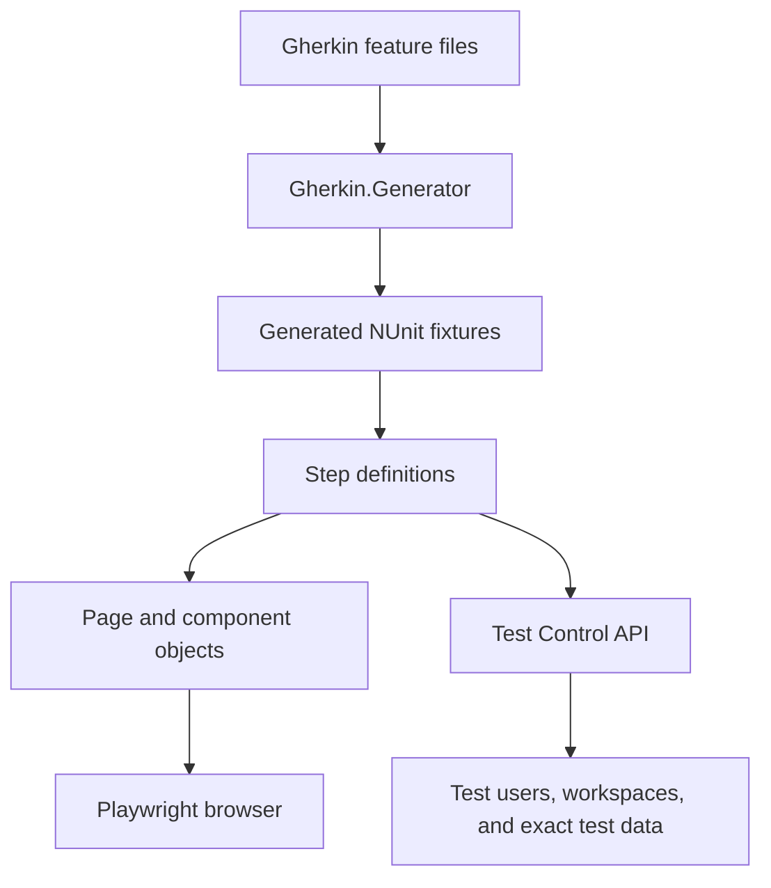

# Functional Test Architecture

The functional test suite separates scenario intent, step orchestration, browser interaction, and
test infrastructure.

## Responsibilities

- **Features** ([`Features/`](../Features/)) describe scenarios in Gherkin. They are the source of
  truth for the intended behavior.
- **Generated fixtures** are produced at build time by `Gherkin.Generator`. They provide NUnit test
  methods and invoke the matching steps. The generator's default template is used; there is no
  project-specific Mustache template to maintain.
- **Steps** ([`Steps/`](../Steps/)) bind Gherkin phrases using `[Given]`, `[When]`, and `[Then]`
  attributes. They coordinate setup and assertions without owning UI locators.
- **Page and component objects** ([`Pages/`](../Pages/), [`Components/`](../Components/)) encapsulate
  Playwright locators, UI operations, and readiness waits.
- **Infrastructure** ([`Infrastructure/`](../Infrastructure/)) provides `FunctionalTestBase`,
  `ITestContext`, resource tracking, and the generated Test Control API client.

Step classes receive `ITestContext`, which gives them access to the browser page, object store,
Test Control client, page-object factory, and per-test resource helpers. Keep step classes focused
by feature/domain and reuse existing definitions where their behavior matches.

## Setup Through APIs, Assertions Through the Browser

Use Test Control APIs to create users, workspaces, and precisely specified domain data. This avoids
slow, brittle UI setup. Use Playwright through page/component objects for the behavior the user
would perform and the user-visible state the test needs to verify.

For transaction setup, the preferred operation is
`TestControlClient.TestControl_SeedTransactionsPreciseAsync`. It accepts the scenario's transaction
values and returns the created transactions. See [Test Control](TEST-CONTROLS.md) for the step
definitions and payload patterns.

## Generated Files

Build output is written under `obj/GeneratedFiles/`. The Gherkin generator creates NUnit fixtures
and a `StepCatalog.g.cs` initializer there. When the test assembly loads, that initializer writes
`YoFi.V3.Tests.Functional.StepCatalog.md` beside the assembly (for example,
`bin/Debug/net10.0/`). NSwag also generates the Test Control client during the project build. These
are generated artifacts. Make changes to feature files, step definitions, and generator
configuration—not to generated output.

The generator is configured in
[`YoFi.V3.Tests.Functional.csproj`](../YoFi.V3.Tests.Functional.csproj). Feature files are its
additional inputs; only top-level `Features/*.feature` files are included, and the package supplies
its default template. Files under `Features/future/` are not generator inputs.
